# CtfAgent

Projet réalisé dans le cadre du semestre 3 à l'UQAC.

## Objectif

CtfAgent vise à concevoir des **agents autonomes basés sur des LLM capables de résoudre des défis CTF (Capture The Flag)** de bout en bout : analyser l'énoncé, explorer les fichiers ou services fournis, exécuter des outils, raisonner sur les résultats et retrouver le flag, sans intervention humaine.

L'objectif est d'évaluer jusqu'où un agent peut aller seul sur des challenges de sécurité, et quelles architectures (agent unique, multi-agents, agents spécialisés par catégorie) donnent les meilleurs résultats.

## Architecture des agents

Un **orchestrateur** reçoit le challenge, le classe puis le confie à l'**agent spécialisé** de sa catégorie. Les catégories reprennent celles de la base de challenges : `web`, `crypto`, `rev`, `pwn`, `forensics`, `misc`.

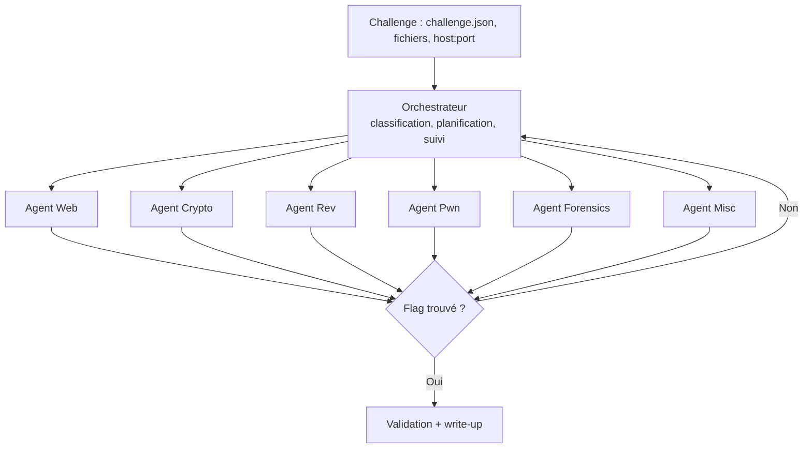

Chaque agent est composé de trois éléments :

| Élément | Format | Rôle |
|---|---|---|
| **Prompt** (`prompt.md`) | Markdown | Rôle de l'agent, méthodologie générale, règles à respecter |
| **Skills** (`skills/*.md`) | Markdown | Fiches de connaissances sur une technique d'attaque (signes qui doivent la faire reconnaître, étapes, commandes, pièges). Elles sont chargées dans le contexte de l'agent seulement quand elles sont utiles. |
| **Tools** (`tools/*.py`) | Python | Fonctions que l'agent peut appeler : elles enveloppent des outils existants (sqlmap, Ghidra, tshark…) et renvoient une sortie courte et exploitable |

## Structure du dépôt

```
CtfAgent/
├── Readme.md
├── .gitignore
├── .env.example                  # modèle des clés API (le vrai .env n'est jamais commité)
│
├── CSAW26_LLMAC_DB/              # base de challenges (dépôt NYU-LLM-CTF)
│   ├── dataset.json              # index de tous les challenges
│   └── 2026/CSAW-Quals/
│       └── <catégorie>/<challenge>/
│           ├── challenge.json    # nom, catégorie, énoncé, fichiers, flag attendu
│           ├── files/ ...        # fichiers donnés au joueur
│           └── solution/ ...     # ⚠️ jamais visible par les agents
│
├── agents/
│   ├── orchestrator/
│   │   ├── prompt.md
│   │   ├── skills/
│   │   │   └── triage.md
│   │   └── tools/
│   │       ├── classify_challenge.py
│   │       └── write_report.py
│   │
│   ├── web/
│   │   ├── prompt.md
│   │   ├── skills/
│   │   │   ├── recon_web.md
│   │   │   ├── sqli.md
│   │   │   ├── auth_jwt_oidc.md
│   │   │   ├── mass_assignment_type_juggling.md
│   │   │   ├── path_traversal_lfi.md
│   │   │   └── business_logic.md
│   │   └── tools/
│   │       ├── http_session.py
│   │       ├── fuzz_paths.py
│   │       ├── run_sqlmap.py
│   │       └── jwt_tool.py
│   │
│   ├── crypto/
│   │   ├── prompt.md
│   │   ├── skills/
│   │   │   ├── encodings_classical.md
│   │   │   ├── rsa_attacks.md
│   │   │   ├── lattice_lll_knapsack.md
│   │   │   ├── prng_seed_recovery.md
│   │   │   └── media_hidden_messages.md
│   │   └── tools/
│   │       ├── auto_decode.py
│   │       ├── rsa_attack.py
│   │       ├── sage_exec.py
│   │       └── factordb.py
│   │
│   ├── rev/
│   │   ├── prompt.md
│   │   ├── skills/
│   │   │   ├── static_analysis.md
│   │   │   ├── dynamic_analysis.md
│   │   │   ├── anti_analysis_self_modifying.md
│   │   │   ├── custom_vm.md
│   │   │   └── symbolic_execution.md
│   │   └── tools/
│   │       ├── decompile.py
│   │       ├── disassemble.py
│   │       ├── gdb_trace.py
│   │       └── angr_solve.py
│   │
│   ├── pwn/
│   │   ├── prompt.md
│   │   ├── skills/
│   │   │   ├── protections_recon.md
│   │   │   ├── stack_overflow_rop.md
│   │   │   ├── heap_uaf_tcache.md
│   │   │   ├── function_pointer_overwrite.md
│   │   │   └── format_string.md
│   │   └── tools/
│   │       ├── checksec.py
│   │       ├── find_offset.py
│   │       ├── rop_gadgets.py
│   │       ├── libc_lookup.py
│   │       └── remote_interact.py
│   │
│   ├── forensics/
│   │   ├── prompt.md
│   │   ├── skills/
│   │   │   ├── pcap_covert_channels.md
│   │   │   ├── image_stego_png.md
│   │   │   ├── logs_memory_analysis.md
│   │   │   └── file_recovery_backups.md
│   │   └── tools/
│   │       ├── pcap_summary.py
│   │       ├── stego_scan.py
│   │       ├── carve_files.py
│   │       └── log_search.py
│   │
│   └── misc/
│       ├── prompt.md
│       ├── skills/
│       │   ├── audio_analysis.md
│       │   ├── web_crawling_puzzles.md
│       │   ├── windows_binaries_archives.md
│       │   └── scripting_services.md
│       └── tools/
│           ├── spectrogram.py
│           ├── dtmf_decode.py
│           ├── crawl_site.py
│           └── remote_interact.py
│
├── tools/common/                 # tools partagés par tous les agents
│   ├── run_in_sandbox.py
│   ├── python_exec.py
│   ├── file_ops.py
│   ├── find_flag.py
│   └── memory.py
│
├── sandbox/
│   ├── Dockerfile                # image Kali/Ubuntu contenant tous les outils CTF
│   └── requirements.txt
│
├── runner/
│   ├── load_challenge.py         # lit challenge.json et ne copie que les fichiers listés
│   ├── run_challenge.py          # lance l'orchestrateur sur un challenge
│   └── evaluate.py               # lance toute la base et compare au flag attendu
│
└── results/                      # journaux, write-ups et scores (non commités)
```

## Base de challenges

Les challenges proviennent de [CSAW26_LLMAC_DB](https://github.com/NYU-LLM-CTF/CSAW26_LLMAC_DB) (CSAW Quals 2026). Ils sont **23**, répartis en 6 catégories :

| Catégorie | Challenges | Service à lancer (Docker) |
|---|---|---|
| `web` | csale, flagchecker, golf_heist, juggler, low_tide, trustdinoidc | Oui (tous) |
| `crypto` | finders_keepers, polly, secret_treaties, taking_on_the_temple | polly, taking_on_the_temple |
| `rev` | autobahn, machine_head, music_sec_dept | Non |
| `pwn` | diamond_dogs, hells_bells, saint_vespers_and_the_copper_choir | Oui (tous) |
| `forensics` | breach_zero_day, ghost_in_the_machine, hemispheres, schrodingers_backup | Non |
| `misc` | 12345678, house_of_hollow_houses, keep_walking_forward | house_of_hollow_houses |

> ⚠️ **Règle anti-triche** : chaque `challenge.json` contient le flag attendu, et plusieurs dossiers contiennent `solution/`, `solve.py` ou `writeup.md`. Le runner copie dans la sandbox **uniquement** l'énoncé et les fichiers listés dans `files`. Les agents n'ont jamais accès au reste du dossier. Le flag sert seulement à `evaluate.py` pour vérifier le résultat.

## Agents, skills et tools

### Orchestrateur

- **Skills**
  - `triage.md` : lire l'énoncé, repérer les indices (« Connect: nc », type de fichier, mots-clés) et choisir l'agent
- **Tools**
  - `classify_challenge` : déduire la catégorie à partir de l'énoncé et des fichiers
  - `write_report` : générer le write-up final à partir du journal

### Agent Web

*Challenges ciblés : csale, flagchecker, golf_heist, juggler, low_tide, trustdinoidc*

- **Skills**
  - `recon_web.md` : explorer le site (robots.txt, sources, endpoints cachés, en-têtes)
  - `sqli.md` : détecter et exploiter une injection SQL
  - `auth_jwt_oidc.md` : JWT falsifiable, flux OIDC/OAuth mal vérifiés (trustdinoidc)
  - `mass_assignment_type_juggling.md` : paramètres en trop acceptés par le serveur, comparaisons laxistes en PHP (juggler)
  - `path_traversal_lfi.md` : lecture de fichiers via des pages oubliées (low_tide)
  - `business_logic.md` : prix négatifs, coupons réutilisés, conditions de course (csale, golf_heist)
- **Tools**
  - `http_session` : requêtes HTTP qui conservent les cookies et l'historique
  - `fuzz_paths` : ffuf/gobuster pour découvrir des chemins
  - `run_sqlmap` : sqlmap avec une sortie résumée
  - `jwt_tool` : décoder, forger et brute-forcer des JWT

### Agent Crypto

*Challenges ciblés : finders_keepers, polly, secret_treaties, taking_on_the_temple*

- **Skills**
  - `encodings_classical.md` : Base64, hex, XOR, César, Vigenère…
  - `rsa_attacks.md` : e petit, n factorisable, Fermat, Wiener, module commun
  - `lattice_lll_knapsack.md` : attaques par réseaux, sac à dos de faible densité (secret_treaties)
  - `prng_seed_recovery.md` : retrouver la graine d'un générateur pseudo-aléatoire (polly)
  - `media_hidden_messages.md` : messages cachés dans une vidéo ou une image (finders_keepers)
- **Tools**
  - `auto_decode` : essayer automatiquement des chaînes d'encodages
  - `rsa_attack` : lancer RsaCtfTool avec les paramètres détectés
  - `sage_exec` : exécuter un script SageMath (LLL, arithmétique modulaire)
  - `factordb` : chercher la factorisation connue d'un entier

### Agent Rev

*Challenges ciblés : autobahn, machine_head, music_sec_dept*

- **Skills**
  - `static_analysis.md` : file, strings, lecture du pseudo-code
  - `dynamic_analysis.md` : ltrace, strace, gdb, points d'arrêt sur les comparaisons
  - `anti_analysis_self_modifying.md` : code chiffré ou modifié à l'exécution (autobahn)
  - `custom_vm.md` : rétro-ingénierie d'une machine virtuelle maison et de son jeu d'instructions (machine_head)
  - `symbolic_execution.md` : résoudre une vérification de mot de passe avec angr ou z3
- **Tools**
  - `decompile` : Ghidra headless, renvoie le pseudo-code d'une fonction
  - `disassemble` : radare2 / objdump
  - `gdb_trace` : exécuter avec des points d'arrêt et récupérer registres et mémoire
  - `angr_solve` : exécution symbolique vers une adresse cible

### Agent Pwn

*Challenges ciblés : diamond_dogs, hells_bells, saint_vespers_and_the_copper_choir*

- **Skills**
  - `protections_recon.md` : lire checksec (NX, PIE, canary, RELRO) et choisir la stratégie
  - `stack_overflow_rop.md` : ret2win, ret2libc, chaînes ROP
  - `heap_uaf_tcache.md` : use-after-free, double free, empoisonnement du tcache (diamond_dogs, hells_bells)
  - `function_pointer_overwrite.md` : écraser un pointeur de fonction ou un callback (saint_vespers)
  - `format_string.md` : fuite et écriture avec `%p` / `%n`
- **Tools**
  - `checksec` : protections du binaire
  - `find_offset` : offset d'un débordement via un motif cyclique
  - `rop_gadgets` : ROPgadget / one_gadget
  - `libc_lookup` : identifier la libc à partir d'adresses qui ont fuité
  - `remote_interact` : dialoguer avec le service (pwntools)

### Agent Forensics

*Challenges ciblés : breach_zero_day, ghost_in_the_machine, hemispheres, schrodingers_backup*

- **Skills**
  - `pcap_covert_channels.md` : canaux cachés dans le trafic (timing, tailles, champs d'en-tête) (ghost_in_the_machine)
  - `image_stego_png.md` : chunks PNG, LSB, données après la fin du fichier (hemispheres)
  - `logs_memory_analysis.md` : corréler PCAP, dump mémoire et journaux XML (breach_zero_day)
  - `file_recovery_backups.md` : reconstruire des fichiers à partir de sauvegardes ou de journaux WAL (schrodingers_backup)
- **Tools**
  - `pcap_summary` : tshark, résumé des protocoles, flux et fichiers extractibles
  - `stego_scan` : exiftool, binwalk, zsteg et steghide en série
  - `carve_files` : binwalk / foremost
  - `log_search` : recherche et filtrage dans de gros journaux

### Agent Misc

*Challenges ciblés : 12345678, house_of_hollow_houses, keep_walking_forward*

- **Skills**
  - `audio_analysis.md` : spectrogramme, DTMF, morse, SSTV (12345678)
  - `web_crawling_puzzles.md` : explorer un labyrinthe de pages et lire les indices cachés (house_of_hollow_houses)
  - `windows_binaries_archives.md` : exécutables Windows (PE), archives, métadonnées de version (keep_walking_forward)
  - `scripting_services.md` : automatiser un dialogue avec un service `nc`
- **Tools**
  - `spectrogram` : générer l'image du spectrogramme d'un fichier audio
  - `dtmf_decode` : décoder des tonalités téléphoniques
  - `crawl_site` : parcourir un site et en extraire les liens, commentaires et éléments cachés
  - `remote_interact` : dialoguer avec un service

### Tools communs (`tools/common/`)

- `run_in_sandbox` : exécuter une commande dans le conteneur isolé, avec un timeout et une sortie tronquée
- `python_exec` : exécuter un script Python dans la sandbox
- `file_ops` : lire, écrire et lister les fichiers du challenge
- `find_flag` : chercher le format de flag (`csaw{...}` par défaut, configurable) dans une sortie
- `memory` : noter les pistes déjà essayées pour éviter de tourner en rond

## Fonctionnement envisagé

1. **Lecture du challenge** : l'agent reçoit l'énoncé, les fichiers joints et/ou l'adresse du service.
2. **Classification** : l'orchestrateur identifie la catégorie et choisit l'agent spécialisé.
3. **Boucle d'action** : l'agent charge les skills utiles, planifie, appelle ses tools, observe les résultats et ajuste son approche.
4. **Validation** : détection du format de flag et comparaison avec le flag attendu (`evaluate.py`).
5. **Rapport** : production d'un write-up retraçant la démarche suivie.

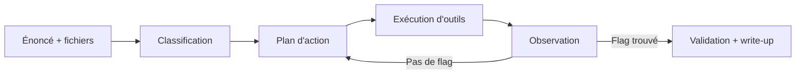

## Exemples de cas à résoudre

Dix scénarios typiques de CTF que les agents devront savoir traiter, avec le raisonnement attendu.

### 1. Web : injection SQL sur un formulaire de connexion

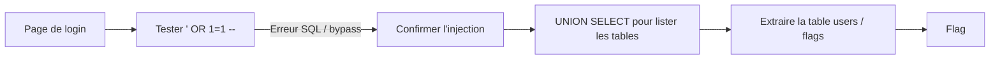

### 2. Web : jeton JWT mal signé

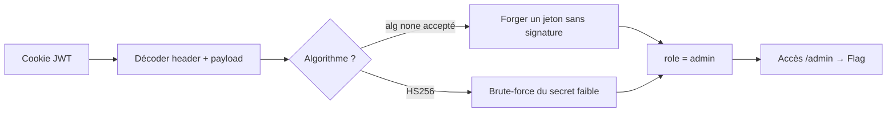

### 3. Web : inclusion de fichier local (LFI)

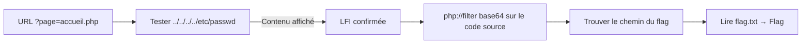

### 4. Crypto : chaîne d'encodages

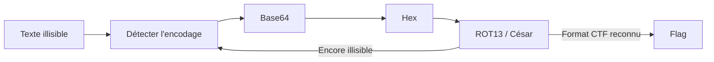

### 5. Crypto : RSA avec paramètres faibles

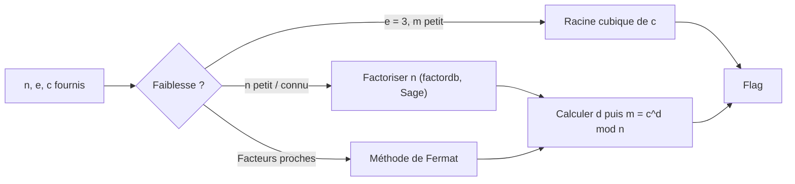

### 6. Reverse : crackme vérifiant un mot de passe

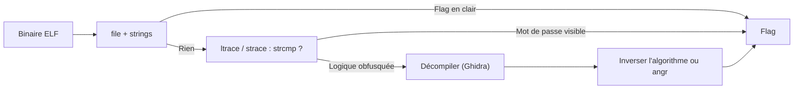

### 7. Pwn : débordement de tampon (ret2win)

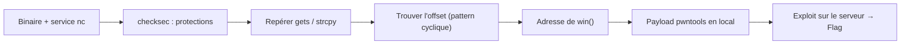

### 8. Forensics : capture réseau (PCAP)

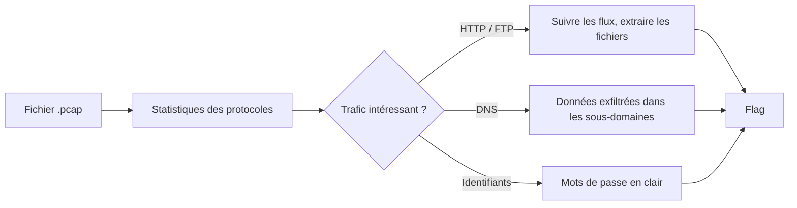

### 9. Stéganographie : image suspecte

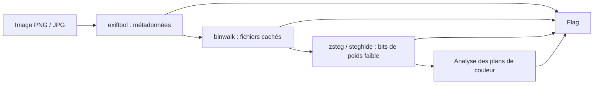

### 10. Misc : service à automatiser

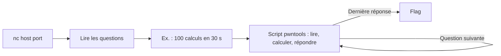

## Sécurité et éthique

- Les agents s'exécutent dans un **environnement isolé** (conteneur Docker) : ils ne doivent pas affecter la machine hôte.
- Ils ne ciblent que des **challenges CTF autorisés** : la base CSAW lancée en local, des plateformes d'entraînement, ou des compétitions dont les règles permettent l'usage d'outils automatisés.
- Les agents n'ont **jamais accès aux flags ni aux solutions** de la base (voir la règle anti-triche plus haut).
- Aucune clé API ni aucun secret ne doit être commité : utiliser un fichier `.env` (ignoré par git).

## Installation

> À compléter (dépendances, configuration des clés API, construction de l'image `sandbox/`).

## Utilisation

> À compléter. Exemple visé :
>
> ```bash
> python runner/run_challenge.py CSAW26_LLMAC_DB/2026/CSAW-Quals/crypto/secret_treaties
> python runner/evaluate.py --category web
> ```

## Équipe

- Simon
- …
