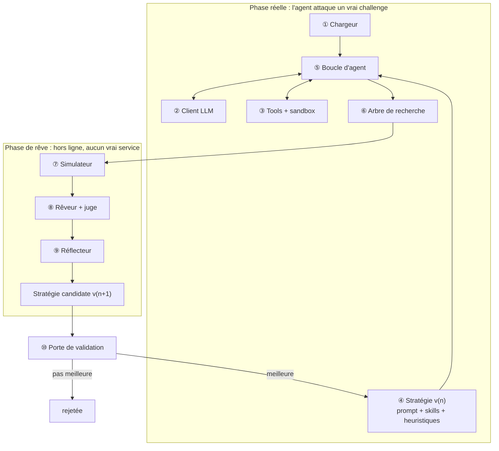

# CtfAgent

Agent autonome de résolution de CTF qui s'améliore en « rêvant » de ses tentatives passées, inspiré de Dream-RSI (Google DeepMind). **Les poids du modèle ne changent jamais** : seule la stratégie (`policy/vN/`, des fichiers texte) évolue.

## Vue d'ensemble



## Arborescence

```
CtfAgent/
├── core/
│   ├── llm.py            ② client LLM
│   ├── loader.py         ① chargeur de challenge
│   ├── sandbox.py        ③ exécution Docker
│   ├── tools.py          ③ définition des tools
│   ├── agent.py          ⑤ boucle d'agent
│   └── tree.py           ⑥ arbre de recherche (SQLite)
├── dream/
│   ├── simulator.py      ⑦ simulateur
│   ├── dreamer.py        ⑧ rêveur + juge
│   └── reflector.py      ⑨ réflecteur
├── policy/
│   ├── v0/               ④ stratégie de départ (écrite à la main, générique)
│   └── v1/ ...           ④ versions apprises
├── runner/
│   ├── gate.py           ⑩ porte de validation
│   ├── rsi_loop.py       boucle principale
│   └── evaluate.py       évaluation finale
├── data/trees.db
└── CSAW26_LLMAC_DB/      base de challenges (NYU-LLM-CTF)
```

## Rôle de chaque partie

| Partie | Rôle | Phase |
|---|---|---|
| ① **Chargeur** | Prépare le workspace avec l'énoncé et les fichiers du joueur. Le flag et les solutions ne sont **jamais** transmis à l'agent. | réelle |
| ② **Client LLM** | Point d'accès unique au modèle (vLLM sur le DGX, API compatible OpenAI). Sert aux 4 rôles : acteur, juge, réflecteur, et modèle du monde (optionnel). | les deux |
| ③ **Tools + sandbox** | Les « mains » de l'agent : commandes exécutées dans un conteneur Docker isolé, sans Internet, avec sortie tronquée. `set_hypothesis` ouvre une nouvelle branche de l'arbre. | réelle |
| ④ **Stratégie** | **Ce qui apprend** : prompt, heuristiques de recherche et skills, en Markdown. Générique, sans aucun nom de challenge. | les deux |
| ⑤ **Boucle d'agent** | Le LLM choisit un tool, on l'exécute, on lui renvoie le résultat. Le même code tourne en réel (sandbox) et en rêve (simulateur). | les deux |
| ⑥ **Arbre de recherche** | Mémoire de toutes les tentatives : hypothèses, actions, observations. Le chemin qui mène au flag est marqué. | réelle → rêve |
| ⑦ **Simulateur** | Rejoue le monde à partir de l'arbre : une action déjà vue renvoie sa sortie enregistrée ; une action inconnue renvoie `[NON SIMULÉ]`. | rêve |
| ⑧ **Rêveur + juge** | Relance l'agent depuis les mauvaises bifurcations. Le juge note chaque branche selon si elle rejoint le chemin gagnant, et en combien d'étapes. Un flag rêvé ne compte jamais. | rêve |
| ⑨ **Réflecteur** | Transforme les rêves en au plus 3 modifications de la stratégie, chacune justifiée. Un filtre rejette toute fuite (nom de challenge, flag). | rêve |
| ⑩ **Porte de validation** | Teste la stratégie candidate pour de vrai sur un ensemble de validation. Elle n'est adoptée que si elle résout au moins autant de challenges en moins d'étapes. | validation |

## Boucle RSI

1. **Réel** : l'agent attaque les challenges d'entraînement (anciens CSAW) et enregistre ses arbres.
2. **Rêve** : sur les challenges résolus, il rejoue les mauvaises bifurcations dans le simulateur.
3. **Réflexion** : les rêves produisent une stratégie candidate.
4. **Validation** : la candidate n'est adoptée que si elle fait mieux.
5. On répète 2 à 3 fois, puis **évaluation finale unique** sur CSAW 2026, jamais vu.

**Séparation des données :** entraînement (anciens CSAW) / validation / test (CSAW 2026). Les challenges de test ne servent jamais à rêver.
