# CtfAgent

Projet réalisé dans le cadre du semestre 3 à l'UQAC.

## Objectif

CtfAgent vise à concevoir des **agents autonomes basés sur des LLM capables de résoudre des défis CTF (Capture The Flag)** de bout en bout : analyser l'énoncé, explorer les fichiers ou services fournis, exécuter des outils, raisonner sur les résultats et retrouver le flag, sans intervention humaine.

L'objectif est d'évaluer jusqu'où un agent peut aller seul sur des challenges de sécurité, et quelles architectures (agent unique, multi-agents, agents spécialisés par catégorie) donnent les meilleurs résultats.

## Architecture des agents

Un **orchestrateur** reçoit le challenge, le classe puis le confie à un **agent spécialisé**. Chaque agent dispose de ses propres outils, en plus d'un socle d'outils communs.

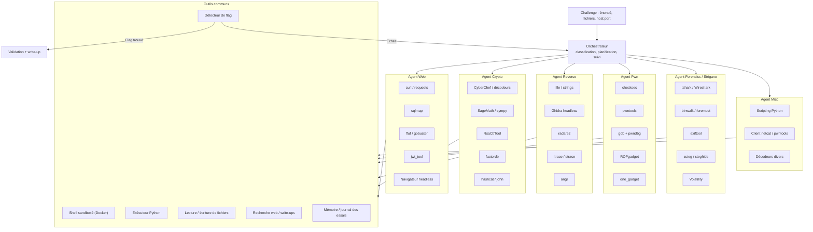

### Outils à développer nous-mêmes

En plus des outils existants, chaque agent aura besoin d'**outils maison** pour que le LLM puisse les utiliser simplement et de façon sûre :

| Outil | Agent(s) | Rôle |
|---|---|---|
| `run_in_sandbox` | Tous | Exécuter une commande dans le conteneur isolé, avec timeout et limite de taille de sortie |
| `find_flag` | Tous | Chercher le format de flag (regex configurable) dans une sortie ou un fichier |
| `memory` | Tous | Garder une trace des pistes essayées pour éviter de tourner en rond |
| `classify_challenge` | Orchestrateur | Déduire la catégorie à partir de l'énoncé et des fichiers |
| `http_session` | Web | Garder les cookies et l'historique des requêtes entre les étapes |
| `auto_decode` | Crypto, Misc | Essayer automatiquement une chaîne d'encodages (Base64, hex, ROT…) |
| `rsa_attack` | Crypto | Lancer les attaques RSA classiques selon les paramètres détectés |
| `decompile` | Reverse, Pwn | Interroger Ghidra en mode headless et renvoyer le pseudo-code d'une fonction |
| `find_offset` | Pwn | Calculer automatiquement l'offset d'un débordement de tampon |
| `remote_interact` | Pwn, Misc | Dialoguer avec un service `nc` (envoyer, lire, attendre un motif) |
| `pcap_summary` | Forensics | Résumer une capture : protocoles, flux, fichiers extractibles |
| `stego_scan` | Forensics | Lancer en série exiftool, binwalk, zsteg et steghide, puis résumer les résultats |
| `write_report` | Orchestrateur | Générer le write-up final à partir du journal |

## Périmètre

Catégories de challenges visées :

- **Web** : injections, failles d'authentification, mauvaises configurations
- **Crypto** : chiffrements faibles, mauvaises utilisations de primitives
- **Reverse** : analyse de binaires et de scripts
- **Pwn** : exploitation de binaires (débordements, format strings…)
- **Forensics / Stéganographie** : analyse de fichiers, captures réseau, images
- **Misc** : encodages, scripting, énigmes

## Fonctionnement envisagé

1. **Lecture du challenge** : l'agent reçoit l'énoncé, les fichiers joints et/ou l'adresse du service.
2. **Classification** : identification de la catégorie et choix de la stratégie (ou d'un agent spécialisé).
3. **Boucle d'action** : l'agent planifie, exécute des commandes et des outils (`file`, `strings`, `binwalk`, `nmap`, `curl`, Python, `pwntools`, Ghidra…), observe les résultats et ajuste son approche.
4. **Validation** : détection du format de flag (ex. `CTF{...}`) et vérification de la réponse.
5. **Rapport** : production d'un write-up retraçant la démarche suivie.

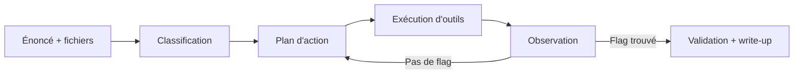

## Exemples de cas à résoudre

Dix scénarios typiques de CTF que les agents devront savoir traiter, avec le raisonnement attendu.

### 1. Web : injection SQL sur un formulaire de connexion

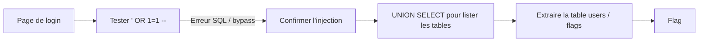

### 2. Web : jeton JWT mal signé

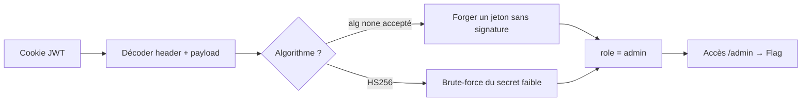

### 3. Web : inclusion de fichier local (LFI)

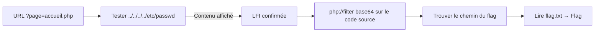

### 4. Crypto : chaîne d'encodages

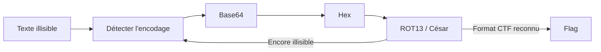

### 5. Crypto : RSA avec paramètres faibles

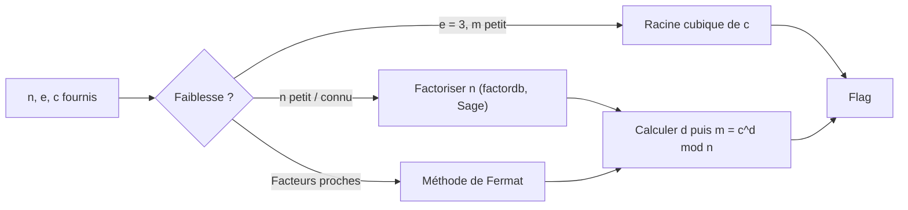

### 6. Reverse : crackme vérifiant un mot de passe

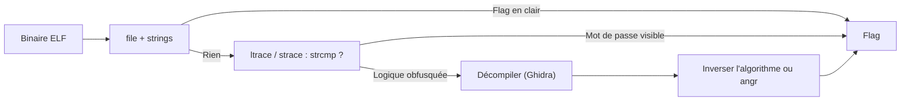

### 7. Pwn : débordement de tampon (ret2win)

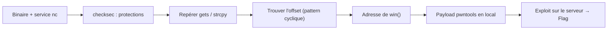

### 8. Forensics : capture réseau (PCAP)

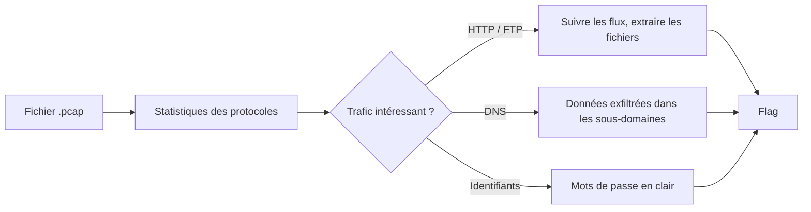

### 9. Stéganographie : image suspecte

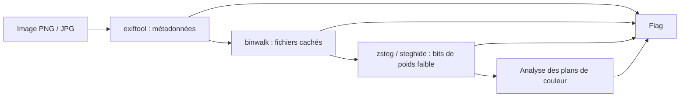

### 10. Misc : service à automatiser

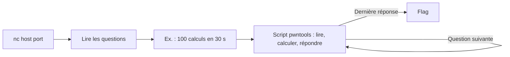

## Sécurité et éthique

- Les agents s'exécutent dans un **environnement isolé** (conteneur / VM) : ils ne doivent pas affecter la machine hôte.
- Ils ne ciblent que des **challenges CTF autorisés** (plateformes d'entraînement, CTF locaux ou compétitions dont les règles permettent l'usage d'outils automatisés).
- Aucune clé API ni aucun secret ne doit être commité : utiliser un fichier `.env` (ignoré par git).

## Structure du dépôt

> À compléter au fur et à mesure du développement.

```
CtfAgent/
├── Readme.md
└── ...
```

## Installation

> À compléter (dépendances, configuration des clés API, lancement de l'environnement isolé).

## Utilisation

> À compléter.

## Équipe

- Simon
- …
